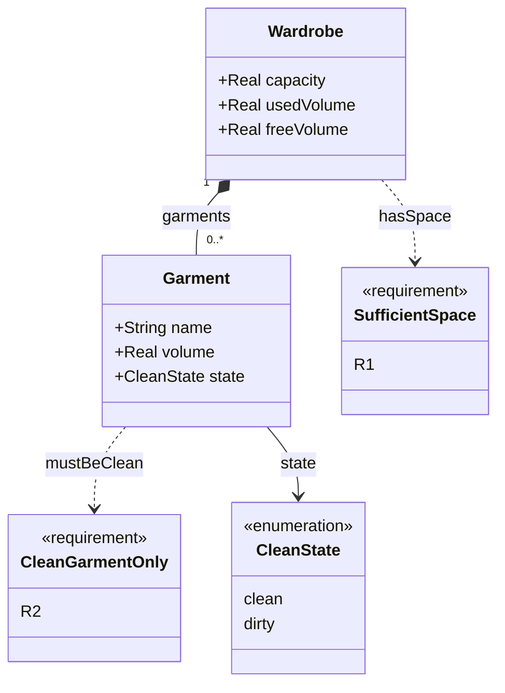
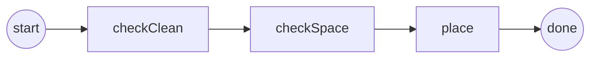

# Architecture summary: WardrobeSystem

_Generated by `tools/summarize.py` from `model/wardrobe.sysml`. Do not edit by hand._

Small teaching model: a wardrobe that stores garments. Covers structure (parts), requirements, and behaviour (the "store garment" process).

## Structure

## Process: StoreGarment

Store one garment in the wardrobe. Preconditions are the two requirements above: the garment is clean (R2) and the wardrobe has free space (R1).

## Requirements

| ID | Name | Statement | Constraint |
|----|------|-----------|------------|
| R1 | SufficientSpace | The wardrobe shall have enough free volume for the garment being stored. | `freeVolume >= garmentVolume` |
| R2 | CleanGarmentOnly | Only clean garments shall be stored in the wardrobe. | `garmentState == CleanState::clean` |

## Traceability

| Requirement | Satisfied by |
|-------------|--------------|
| spaceReq (SufficientSpace) | `myWardrobe` |
| cleanReq (CleanGarmentOnly) | `myWardrobe.tShirt` |

## Example configuration check

| Wardrobe | Garment | Free volume | Garment volume | State | Result |
|----------|---------|-------------|----------------|-------|--------|
| myWardrobe | tShirt | 60 | 2 | clean | allowed |
| myWardrobe | jeans | 60 | 5 | dirty | rejected: R2 fails: garment is dirty |
